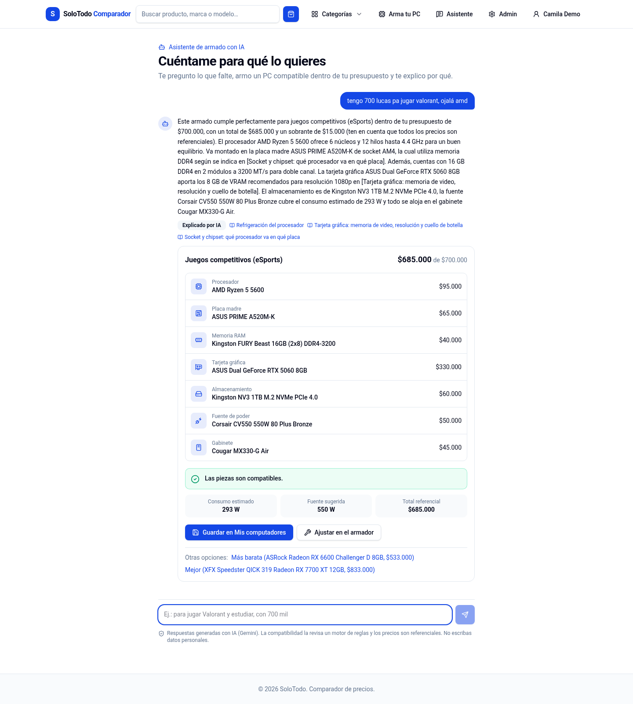
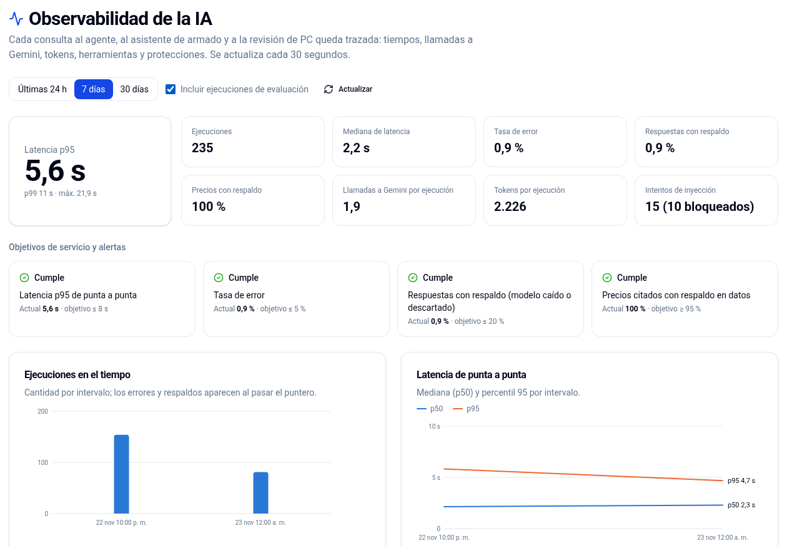

# TodoBarato AI

Comparador de precios de tecnología para Chile con un **armador de PC que no se equivoca de compatibilidad** y un
**agente con Gemini** que pregunta lo que falta, arma el computador según tus necesidades, lo explica con fuentes y lo
guarda en tu perfil («Mis computadores»). Cada consulta a la IA queda trazada y medida en un panel de observabilidad.

| Entrega | Qué cubre | Dónde está |
|---|---|---|
| **ISY0101 · Evaluación Parcial 3** (observabilidad) | Métricas de precisión, latencia, consistencia, errores y recursos; trazas y análisis de logs; dashboard; recomendaciones; seguridad y privacidad | [`docs/entrega/ISY0101-EP3.md`](docs/entrega/ISY0101-EP3.md) |
| **ISY0101 · Evaluación Final Transversal** | Caso, prompts, RAG (fuentes internas y externas), arquitectura, agente con herramientas, memoria, planificación, observabilidad y seguridad; notebook de Colab | [`docs/entrega/ISY0101-EFT.md`](docs/entrega/ISY0101-EFT.md) · [`notebooks/EFT_ISY0101.ipynb`](notebooks/EFT_ISY0101.ipynb) |
| **ITY1102 · Evaluación Parcial 3** (despliegue) | Modelo de emparejamiento, API `/ml`, RabbitMQ, despliegue medido en AWS, pruebas de carga | [`EP3_ITY1102/README.md`](EP3_ITY1102/README.md) · redespliegue para la defensa: [`docs/entrega/DEPLOY_DEFENSA.md`](docs/entrega/DEPLOY_DEFENSA.md) |
| Matriz de cumplimiento de las tres pautas | Cada indicador con su evidencia (archivo, ruta o página) | [`docs/entrega/matriz-cumplimiento.md`](docs/entrega/matriz-cumplimiento.md) |
| ISY0101 · Evaluación Parcial 2 (agente) | Arquitectura del agente LangGraph | [`docs/agente/ARQUITECTURA.md`](docs/agente/ARQUITECTURA.md) |

## Qué hace

| Página | Para qué |
|---|---|
| `/armar` | Armador pieza por pieza: cada opción dice si calza (socket, tipo de memoria, medidas del gabinete, watts de la fuente). |
| `/armar/asistente` | Chat con Gemini: pregunta uso y presupuesto si faltan, arma un PC compatible y explica por qué, citando las guías. |
| `/mis-pc` y `/mis-pc/[id]` | «Mis computadores»: tus equipos (propios o proyectos), su compatibilidad y una revisión con IA que propone mejoras. |
| `/guias` | Guías de compatibilidad; son la base de conocimiento (RAG) que consulta la IA. |
| `/chat` | Agente de ahorro y armado: busca, compara, revisa historial de precios, crea alertas y listas, y usa las herramientas del armador. |
| `/perfil` | Cuenta, descarga y borrado de todos tus datos (Ley 19.628 y Ley 21.719) y cómo usamos la IA. |
| `/observabilidad` | Panel para administradores: latencia p50/p95/p99, errores, respaldos, tokens, herramientas, objetivos de servicio y la cascada de cada ejecución. |

<p>
  
  
</p>

Más capturas en [`docs/entrega/capturas/`](docs/entrega/capturas/).

**La IA no decide la compatibilidad.** Un motor de reglas (`app/pcbuilder/`) revisa socket, chipset, memoria, medidas,
refrigeración y consumo; Gemini entiende el pedido y explica el resultado. Si la explicación cita un precio que no está en
los datos, se descarta y se responde con la explicación por reglas.

## Inicio rápido (local, sin Docker)

Requisitos: Python 3.12 con [uv](https://docs.astral.sh/uv/), Node 20+ con `pnpm` y, para la IA, una llave de Gemini.

```bash
# 1. Backend
uv venv --python 3.12 .venv
uv pip install -e '.[dev,ml,mensajeria]'
cp .env.example .env        # complete AUTH_JWT_SECRET y GEMINI_API_KEY (ver «Configuración»)
DATABASE_URL=sqlite:///./todobarato.db .venv/bin/python -m uvicorn app.main:app --port 8000
#    Al arrancar crea las tablas y siembra las piezas del armador; las guías se cargan en la primera búsqueda.

# 2. Frontend (otra terminal)
cd frontend && pnpm install && pnpm dev     # http://localhost:3000
```

Cree una cuenta en `/register`. Sin `ADMIN_EMAILS` y con `APP_ENV` distinto de `production`, cualquier cuenta ve el panel
`/observabilidad` (solo para desarrollo); en producción ponga ahí los correos de los administradores.

## Precios de tiendas e imágenes (SoloTodo)

El armador muestra precios de tiendas chilenas reales (PC Factory, Winpy, MyShop…) y la foto de cada pieza, tomados de
la API pública de SoloTodo (`publicapi.solotodo.com`, JSON; no se raspa HTML). Qué producto de SoloTodo corresponde a cada
pieza está fijado en `app/pcbuilder/solotodo_productos.json`, que genera y deja revisar `scripts/solotodo_mapear.py`.

```bash
python -m app.pcbuilder.solotodo        # trae precios e imágenes a la base configurada (el despliegue en AWS lo corre solo)
python scripts/solotodo_mapear.py       # vuelve a emparejar las piezas (solo si cambian); revisar la tabla antes de subirla
```

Si una pieza no tiene tiendas con stock, el armador usa su «Precio de referencia» (estimado, no es una tienda). Las
evaluaciones usan solo esa semilla, sin red, para que sus resultados se puedan repetir. SP Digital cerró: su conector
ya no se registra.

## Observabilidad, evaluación y trazas

| Qué | Cómo |
|---|---|
| Panel | `/observabilidad` (o `GET /api/v1/observability/metrics?hours=24`, `/runs`, `/runs/{run_id}`) |
| Prometheus / Grafana | `GET /api/v1/observability/prometheus` (formato de texto de Prometheus) |
| Log de cada ejecución | `TRACE_LOG_FILE=logs/trazas.jsonl` (una línea JSON por ejecución, sin datos personales, con rotación) |
| Evaluación con escenarios variables | `.venv/bin/python -m scripts.evaluar_ia --modos gemini,reglas --repeticiones 3 --agente` → `evals/resultados/<etiqueta>.md` y `.json` |
| Análisis de los logs | `.venv/bin/python -m scripts.analizar_trazas --incluir-eval --salida evals/resultados/analisis.md` (o `--db`) |
| Objetivos de servicio | `SLO_P95_MS` (8000), `SLO_ERROR_RATE` (0,05), `SLO_GROUNDED` (0,95), `SLO_FALLBACK_RATE` (0,20) |

La evaluación usa `evals/escenarios.json`: 40 casos del asistente en tres conjuntos (desarrollo, prueba y prueba 2, este
último escrito después de corregir y corrido a ciegas) y 4 del agente. Compara Gemini contra el modo solo reglas. Gasta
unas 150 llamadas a Gemini con 3 repeticiones; use `--solo P01,P02` para correr unos pocos.

## Configuración

Variables principales de `.env` (plantilla completa en `.env.example`; **nunca** suba `.env` al repositorio):

| Variable | Para qué |
|---|---|
| `DATABASE_URL` | PostgreSQL en producción (RDS); sin ella se usa SQLite local. |
| `AUTH_JWT_SECRET` | Firma de los tokens de las cuentas propias. Obligatoria fuera de desarrollo (32+ caracteres aleatorios). |
| `ADMIN_EMAILS` | Correos con acceso al panel de observabilidad y a `/admin`. |
| `LLM_PROVIDER`, `GEMINI_API_KEY`, `GEMINI_MODEL` | Modelo de la IA (`gemini`, `gemini-3.5-flash-lite`). Sin llave, el asistente responde solo con reglas. |
| `ASSISTANT_LLM_TIMEOUT_SECONDS` | Tiempo máximo de una llamada del asistente antes de responder con reglas (10 s). |
| `TRACE_LOG_FILE`, `TRACE_PERSIST`, `TRACE_SALT` | Log JSONL de trazas, guardarlas en la base y la sal del seudónimo del usuario. |
| `RESEARCH_ENABLED`, `MAX_RESEARCH_QUERIES` | Búsqueda en la web (fuente externa del RAG) y su tope de consultas. |
| `PC_AI_RATE_LIMIT_PER_MINUTE` | Límite de consultas a la IA por usuario y minuto (15). |

**Cuentas:** el login es propio (`/api/v1/auth/*`, contraseñas con scrypt y sal aleatoria, tokens JWT firmados). El proyecto de Supabase que se
usaba antes ya no existe; si vuelve, el backend también acepta sus tokens (`SUPABASE_URL`).

## Inicio rápido con Docker

Solo requiere Docker (Docker Desktop en Windows, Docker Engine + `docker compose` en Linux) y el archivo `.env`:

```bash
cp .env.example .env    # complete AUTH_JWT_SECRET y GEMINI_API_KEY
docker compose up --build
```

```text
Frontend: http://localhost:3000
Backend:  http://localhost:8000/health
API docs: http://localhost:8000/docs
```

Detener con `docker compose down`; reconstruir desde cero con `docker compose build --no-cache`. Sin `DATABASE_URL`, el
backend usa SQLite dentro del contenedor.

## Arquitectura

```text
frontend/ (Next.js 16) → API FastAPI (/api/v1) → SQLAlchemy → PostgreSQL (RDS) o SQLite
                            ├─ app/agent/       agente LangGraph (recordar → planificar → actuar → reflexionar → guardar)
                            ├─ app/pcbuilder/   motor de compatibilidad, recomendador, asistente y guías
                            ├─ app/ai/rag/      base de conocimiento (búsqueda híbrida) · app/ai/research/ búsqueda web
                            ├─ app/observability/ trazas, métricas, objetivos de servicio, guardas y enmascarado
                            └─ ml/ + /ml        modelo de emparejamiento de productos (ITY1102)
```

El catálogo separa la identidad del producto de sus ofertas (`Category → Product → StoreOffer → PriceHistory`). El agente
usa Gemini con herramientas de consulta (catálogo, precios, piezas, guías, web), razonamiento (compatibilidad,
recomendación, tendencia de precios) y escritura (alertas, listas, «Mis computadores»), con memoria de corto plazo
(checkpointer) y largo plazo (preferencias con embeddings).

## Migraciones

Los cambios de esquema van por Alembic (`alembic/versions/`); `create_all` se conserva para el primer arranque local:

```bash
alembic upgrade head
alembic revision --autogenerate -m "describe el cambio"
```

## Desarrollo local sin Docker

Use esta opción si quiere ejecutar backend y frontend directamente en el sistema operativo, sin contenedores.

### Backend en Linux/macOS

Desde la raíz del proyecto:

```bash
python -m venv .venv
.venv/bin/python -m pip install -e '.[dev,ml,mensajeria]'
.venv/bin/python -m uvicorn app.main:app --host 127.0.0.1 --port 8000 --reload
```

### Backend en Windows PowerShell

Desde la raíz del proyecto:

```powershell
python -m venv .venv
.\.venv\Scripts\python.exe -m pip install -e ".[dev,ml,mensajeria]"
.\.venv\Scripts\python.exe -m uvicorn app.main:app --host 127.0.0.1 --port 8000 --reload
```

Verificar:

```text
http://127.0.0.1:8000/health
```

### Frontend en Linux/macOS

En otra terminal:

```bash
cd frontend
pnpm install
pnpm dev
```

### Frontend en Windows PowerShell

Si no tiene `pnpm`, puede usar `npm`:

```powershell
cd frontend
npm install
npm run dev
```

Si quiere usar `pnpm`:

```powershell
npm install -g pnpm
cd frontend
pnpm install
pnpm dev
```

Abrir:

```text
http://127.0.0.1:3000
```

Si Next.js muestra `Slow filesystem detected` en Windows, mueva el proyecto a una ruta simple, por ejemplo `C:\proyectos\solotodo-ai`, y evite OneDrive/Google Drive/Dropbox.

## CI / CD (GitHub Actions)

El repositorio tiene **CI en todos los PR/pushes** y un **CD que publica la imagen del backend en GitHub Container Registry (GHCR)** y deja listo (no ejecutado) el despliegue productivo.

### Eventos que activan cada pipeline

| Pipeline | Archivo | Se dispara con |
|---|---|---|
| CI Backend | `.github/workflows/backend.yml` | push/PR a `master` o `main` (solo `app/`, `scripts/`, `tests/`, `pyproject.toml`) → `pytest -q` |
| CI Frontend | `.github/workflows/frontend.yml` | push/PR a `master` o `main` (solo `frontend/`) → `eslint` + `next build` |
| CD Backend | `.github/workflows/cd.yml` | push a `main` **o** creación de tag `v*` (ej. `v1.2.3`) |

> [!NOTE]
> El CD está filtrado a la rama `main` según lo solicitado. Si la rama principal del repo se llama `master`, agrega `master` a `branches:` en `.github/workflows/cd.yml` (y considera renombrar la rama con `git branch -m main`).

### Imagen publicada

- Nombre: `ghcr.io/<owner>/<repository>/backend` (GHCR exige minúsculas; el workflow la calcula con `${GITHUB_REPOSITORY,,}`).
- Ejemplo para este repo: `ghcr.io/niko-ing/proyectoengineer-ai/backend`.
- Etiquetas (resolución de `docker/metadata-action@v5`):

| Evento | Etiquetas |
|---|---|
| push a `main` | `sha-<7>`, `main`, `latest` |
| tag `v1.2.3` | `sha-<7>`, `v1.2.3`, `1.2.3` |
| cualquier push CD | `sha-<7>` (imagen inmutable para rollback) |

`latest` **solo** cuando el evento es push a `main` (no en tags).

### Flujo del CD (`.github/workflows/cd.yml`)

```text
push main / tag v*
   │
   ├─ backend-tests   (pytest)
   ├─ frontend-check  (eslint + next build)
   │        │
   │        ▼
   │  build-and-publish  → docker build → push a GHCR (GITHUB_TOKEN, packages: write)
   │        │
   │        ▼
   │  deploy            → verifica imagen sha-<7> + smoke test /health
   │                     → si hay host+secretos: pull, alembic upgrade head, run, health
   │                     → si NO: reporta qué falta y NO simula un despliegue
```

Gates de despliegue: `deploy` depende de `build-and-publish`, que a su vez depende de los tests y del lint/build del frontend. Si cualquiera falla, **no se publica ni se despliega**. Además, el job `deploy` usa `concurrency` para que nunca haya dos despliegues simultáneos.

### Variables y secretos para activar el despliegue productivo

Configurables en GitHub → Settings → Secrets and variables → Actions:

| Tipo | Nombre | Uso |
|---|---|---|
| Variable | `DEPLOY_HOST` | Host del servidor (IP/DNS) |
| Variable | `DEPLOY_USER` | Usuario SSH |
| Variable | `DEPLOY_PATH` | Ruta de trabajo en el host |
| Secret | `DEPLOY_SSH_KEY` | Llave privada SSH (nunca se imprime) |
| Secret | `DATABASE_URL` | Cadena PostgreSQL (RDS u otra) |
| Secret | `AUTH_JWT_SECRET` | Firma de los tokens de las cuentas propias (32+ caracteres aleatorios) |
| Secret | `LLM_PROVIDER` | `gemini` / `openai` |
| Secret | `GEMINI_API_KEY` | (u otra credencial equivalente) |


**Nunca** se agregan secretos reales al repositorio ni se imprimen en los logs (se pasan por `env` y se escriben en archivos temporales con máscara de ejecución).

### CI implementado vs. publicación en GHCR vs. despliegue productivo

- **CI implementado (funciona hoy):** `pytest` del backend y lint/build del frontend. Es lo único que se ejecuta en cada PR/push.
- **Publicación en GHCR (funciona hoy):** el CD construye la imagen del backend y la sube etiquetada. Se puede verificar con `docker pull`.
- **Despliegue productivo (NO activo):** el job `deploy` verifica e instala la imagen **solo cuando** existan `DEPLOY_HOST`, `DEPLOY_USER`, `DEPLOY_PATH` y `DEPLOY_SSH_KEY`, `DATABASE_URL`. El repositorio no tiene un proveedor de hosting configurado, así que hoy el job reporta el estado pendiente y **no simula** un despliegue exitoso.

### Ejecutar y verificar el workflow

1. Hacer push a `main` o crear un tag:
   ```bash
   git checkout main
   git push origin main
   git tag v0.1.0 && git push origin v0.1.0
   ```
2. Abrir **Actions** en GitHub y verificar el run `CD - Publicar imagen y preparar despliegue` (jobs verde, imagen publicada, smoke test OK, estado del deploy).
3. Verificar la imagen publicada localmente:
   ```bash
   echo "$GITHUB_TOKEN" | docker login ghcr.io -u <usuario> --password-stdin
   docker pull ghcr.io/niko-ing/proyectoengineer-ai/backend:latest
   docker run -d -p 8000:8000 -e DATABASE_URL=sqlite:////tmp/check.db ghcr.io/niko-ing/proyectoengineer-ai/backend:latest
   curl http://localhost:8000/health   # {"status":"ok"}
   ```
   (Ocultar el token; para tokens de máquina se necesitan los scopes `read:packages`.)

### Rollback

Cada imagen publicada queda inmutable con la etiqueta `sha-<sha del commit>`:

1. Buscar el SHA del commit bueno y su tag:
   ```bash
   git log --oneline -10
   docker image inspect ghcr.io/niko-ing/proyectoengineer-ai/backend:sha-<sha>   # ejemplo: sha-869e678
   ```
2. En el host de despliegue, volver a ejecutar el deploy con esa imagen (pull + migraciones + restart):
   ```bash
   docker pull ghcr.io/niko-ing/proyectoengineer-ai/backend:sha-<sha>
   # revisar si la migración reciente necesita downgrade antes de levantar:
   # docker run --rm -e DATABASE_URL=$DATABASE_URL IMG sh -c "alembic downgrade -1"
   docker rm -f todobarato-backend
   docker run -d --name todobarato-backend --restart unless-stopped -p 8000:8000 \
     --env-file .deploy-env ghcr.io/niko-ing/proyectoengineer-ai/backend:sha-<sha>
   curl http://localhost:8000/health   # {"status":"ok"}
   ```
3. Como alternativa a los comandos manuales, redirigir el CD a la rama/tag anterior y volver a correr el workflow desde la UI de Actions (botón **Re-run** sobre el commit deseado).

## Pruebas

```bash
DATABASE_URL=sqlite:///./dev_test.db .venv/bin/python -m pytest -q    # backend (sin red)
cd frontend && pnpm lint && pnpm build                               # frontend
```

En Windows: `.\.venv\Scripts\python.exe -m pytest -q`.
