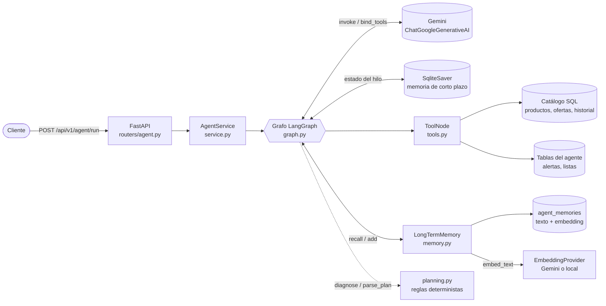
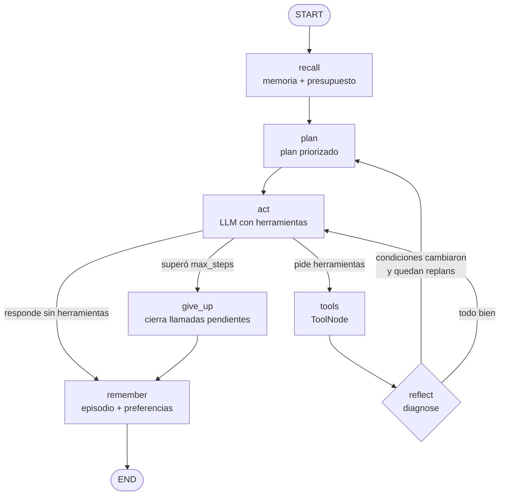

# Agente de ahorro de TodoBarato — arquitectura

Evaluación Parcial 2 (ISY0101): un agente funcional que integra herramientas de **consulta**, **escritura** y **razonamiento** en un flujo de trabajo organizacional simulado, con **memoria**, **planificación** y **toma de decisiones adaptativa**.

## 1. El caso organizacional

TodoBarato es un comparador de precios de tecnología en Chile (catálogo, ofertas por tienda e historial de precios). El flujo que se automatiza es el de un **asesor de compras**: el cliente dice qué necesita y cuánto puede gastar, y hoy un analista tendría que buscar, comparar tiendas, mirar si el precio está inflado, y dejar anotada la lista o una alerta. El agente hace ese trabajo de punta a punta y **deja registro en la base de datos**:

| Qué pide el cliente | Qué hace el agente |
|---|---|
| «Notebook para la universidad, hasta $400.000, arma una lista» | Busca, mira ofertas y stock, juzga si es buen momento, guarda la lista de compra con la mejor oferta |
| «Notebook gamer hasta $300.000, avísame cuando baje» | No hay nada en ese precio → cambia de estrategia → deja una alerta y dice cuánto falta |
| «Revisa mis alertas» | Compara cada alerta con los precios de hoy y avisa las que se cumplieron |
| «Prefiero Samsung, no quiero Huawei» | Lo recuerda en conversaciones futuras |

## 2. Componentes



| Componente | Archivo | Responsabilidad | Pauta |
|---|---|---|---|
| Grafo del agente | `app/agent/graph.py` | Orquesta los nodos `recall → plan → act ⇄ tools → reflect → remember` | IE1, IE2, IE5 |
| Herramientas | `app/agent/tools.py` | 11 herramientas: 8 de consulta/razonamiento y 3 de escritura | IE1 |
| Memoria | `app/agent/memory.py` | Largo plazo con recuperación semántica y ventana de corto plazo | IE3, IE4 |
| Planificación y decisiones | `app/agent/planning.py` | Presupuesto, plan priorizado, diagnóstico de observaciones | IE5, IE7 |
| Servicio | `app/agent/service.py` | Arma todo, ata cada hilo al usuario, entrega una traza | IE1 |
| Modelo guionado | `app/agent/testing.py` | `BaseChatModel` determinista para pruebas y demos sin red | pruebas |
| API | `app/routers/agent.py` | `POST /agent/run`, `GET /agent/memories` | — |
| Datos | `app/models/agent.py`, migración `20260920_01` | `agent_memories`, `price_alerts`, `shopping_lists` | — |

### Herramientas

| Tipo | Herramienta | Qué hace |
|---|---|---|
| Consulta | `search_products`, `get_product_offers`, `get_price_history`, `compare_products`, `get_user_profile` | Reutilizan los servicios del catálogo ya existentes |
| Consulta | `recall_memory` | Búsqueda semántica en la memoria de largo plazo |
| Consulta + marca | `check_price_alerts` | Revisa alertas activas contra los precios de hoy y marca las cumplidas (una sola vez) |
| **Razonamiento** | `analyze_price_trend` | Convierte el historial en un veredicto numérico: `buen_momento` / `precio_normal` / `esperar` / `sin_historial_suficiente` |
| **Escritura** | `create_price_alert` | Crea (o actualiza) una alerta de precio |
| **Escritura** | `save_shopping_list` | Guarda la lista con la mejor oferta de cada producto y el total frente al presupuesto |
| **Escritura** | `remember_preference` | Guarda una preferencia estable del usuario en memoria de largo plazo |

Las herramientas devuelven JSON y, ante un error de negocio (producto inexistente, lista sin ofertas), levantan `ToolException`: el agente lo **ve como observación** y puede replanificar en vez de caerse.

## 3. Flujo del grafo



| Nodo | Qué hace |
|---|---|
| `recall` | Fija el turno, extrae el presupuesto del texto («$800.000», «450 mil», «1,5 millones») y recupera memoria: **núcleo** (preferencias importantes, siempre) + **semántica** (lo más parecido al pedido). |
| `plan` | El LLM propone un plan en JSON con prioridad 1–3. Si responde algo inválido se usa un plan por reglas (`heuristic_plan`): el agente nunca queda sin plan. En un replan **conserva los pasos ya hechos** y no los duplica. |
| `act` | El LLM, con las herramientas enlazadas, decide la próxima acción. Recibe como sistema: reglas, objetivo, presupuesto, memoria, resumen de lo que salió de la ventana, plan vigente y, si hubo replan, la adaptación. |
| `tools` | `ToolNode` de LangGraph ejecuta las herramientas (errores como observación). |
| `reflect` | Lee las observaciones con `diagnose` y decide por reglas si hay que replanificar. Marca como hechos los pasos cuyas herramientas se ejecutaron. |
| `remember` | Guarda un **episodio** («Tarea … → Resultado …») y las preferencias que el usuario declaró (red de seguridad si el LLM no llamó a `remember_preference`). |
| `give_up` | Si se supera `max_steps`, responde con cada llamada pendiente cerrada (el proveedor exige una respuesta por cada `tool_call`) y explica qué alcanzó a hacer. |

## 4. Planificación y decisiones adaptativas

`diagnose` (`planning.py`) mira la última ronda de observaciones. Cada diagnóstico cambia el plan:

| Observación | Diagnóstico | Adaptación |
|---|---|---|
| `search_products` → 0 resultados | `sin_resultados` | Repetir con términos más generales y sin filtro de precio ni marca |
| Todo lo encontrado cuesta más que el presupuesto | `sobre_presupuesto` | Buscar gama inferior; si no hay, alerta de precio e informar cuánto falta |
| Todas las ofertas sin stock | `sin_stock` | Descartar y elegir otra tienda o candidato |
| `analyze_price_trend` → `esperar` | `precio_alto` | No recomendar comprar hoy; alerta cerca del promedio histórico |
| Una herramienta devolvió error | `error_herramienta` | Corregir parámetros y reintentar una vez |

Dos frenos evitan bucles: **máximo 2 replanificaciones** por pedido y **cada motivo solo replanifica una vez** (el segundo `sin_resultados` seguido se registra como `continuar_sin_replan`). Además hay un tope de pasos (`max_steps=10`).

### Ejemplo trazado (historia 2 de la demo)

```mermaid
sequenceDiagram
    participant U as Cliente
    participant G as Grafo
    participant L as LLM
    participant T as Herramientas
    U->>G: «notebook gamer, $300.000, avísame cuando baje»
    G->>L: plan (JSON)
    L-->>G: buscar → ofertas → tendencia → alerta
    G->>L: act
    L->>T: search_products(notebook gamer, tope 300000)
    T-->>G: 0 productos
    Note over G: reflect: sin_resultados → replanificar (1/2)
    G->>L: plan (conserva lo hecho + adaptación)
    L->>T: search_products(notebook gamer) → 0 (sin replan: ya atendido)
    L->>T: search_products(notebook) → mínimo $349.990
    Note over G: reflect: sobre_presupuesto → replanificar (2/2)
    L->>T: get_product_offers, analyze_price_trend
    L->>T: create_price_alert(objetivo 300000)
    L-->>U: «cuesta $349.990, faltan $49.990; dejé una alerta»
```

## 5. Memoria

### Corto plazo — continuidad dentro de una tarea
* El historial de cada hilo vive en el **checkpointer de LangGraph** (`SqliteSaver` en local, archivo `agent_checkpoints.db`; `PostgresSaver` si la app usa Postgres): sobrevive a reinicios del proceso y permite retomar una tarea larga.
* El `thread_id` se guarda como `usuario:hilo`, así que dos usuarios con el mismo id de hilo **nunca** comparten historial.
* A `act` solo se le manda una **ventana** de los últimos 24 mensajes (`window_messages`): nunca empieza con un `ToolMessage` huérfano y siempre incluye el último mensaje humano. Lo recortado se resume sin LLM (`summarize_dropped`: qué pidió el usuario y qué herramientas se usaron), para no perder el hilo.

### Largo plazo — conocimiento entre conversaciones
Tabla `agent_memories` (texto, tipo, embedding, importancia, fechas). Tres tipos: `preference`, `fact` y `episode` (resumen automático de cada tarea).

**Recuperación** (`LongTermMemory.recall`) = memoria núcleo ∪ búsqueda semántica:

```
puntaje = 0,75 · similitud_coseno(consulta, recuerdo)
        + 0,15 · importancia / 5
        + 0,10 · 0,5^(días / 45)          # recencia, vida media de 45 días
```

* **Núcleo:** las preferencias con importancia ≥ 4 se cargan siempre, aunque el pedido no se parezca («Recomiéndame un celular» no comparte palabras con «Prefiero Samsung»).
* **Semántica:** `EmbeddingProvider` (el mismo del RAG del proyecto): Gemini `gemini-embedding-001` o, sin llave, un hash léxico local.
* **Sin duplicados:** un recuerdo idéntico o con similitud ≥ 0,93 no se guarda de nuevo; se refresca su importancia.
* **Aislado por usuario**, y si cambia el proveedor de embeddings los recuerdos se recalculan al vuelo.
* **Degradación:** si el embedding falla, se busca por palabras en común.

## 6. Cómo ejecutar

```bash
uv venv --python 3.12 .venv && uv pip install -e '.[dev]'
.venv/bin/python -m pytest tests/agent -q                      # 88 pruebas, sin red
.venv/bin/python scripts/demo_agente.py                        # 5 historias, modelo guionado
.venv/bin/python scripts/demo_agente.py --live --embeddings gemini   # con Gemini real (.env: GEMINI_API_KEY, GEMINI_MODEL)
RUN_LIVE=1 .venv/bin/python -m pytest tests/agent/test_live_gemini.py -q   # pruebas contra Gemini
```

API (con la app levantada y un token de Supabase):

```bash
curl -X POST localhost:8000/api/v1/agent/run -H "Authorization: Bearer $TOKEN" \
  -H 'Content-Type: application/json' \
  -d '{"message": "Quiero un notebook Lenovo, presupuesto $400.000. Arma una lista.", "thread_id": "demo-1"}'
```

La respuesta trae `answer`, `plan`, `tools_used`, `wrote`, `replans`, `memories_used` y la `trace` completa del turno. Una cuota agotada del modelo responde `429` y otras fallas del proveedor `503`, no un error de servidor.

Migración: `alembic upgrade head` (agrega `agent_memories`, `price_alerts`, `shopping_lists`).

## 7. Evidencia

| Evidencia | Dónde |
|---|---|
| Resultado de las pruebas (88 del agente; 873 en la suite completa) | `docs/agente/evidencia/pytest_agente.txt`, `pytest_suite_completa.txt` |
| Bocetos de diseño (estado, contratos, prompt, esquema de datos) | `docs/agente/DISENO.md` |
| Informe (≤ 5 páginas) y presentación de la exposición (9 diapositivas con notas de apoyo) | `docs/agente/Informe_EP2_Agente_TodoBarato.docx`, `docs/agente/Presentacion_EP2_Agente_TodoBarato.pptx` |
| Pruebas unitarias y de escenarios | `tests/agent/` — 88 pruebas + 3 opt-in (2 Gemini, 1 Postgres) |
| Traza de las 5 historias con modelo guionado | `docs/agente/evidencia/demo_guionada.txt` |
| Traza con Gemini real (historias 1–3 completas; cortó la cuota gratuita en la 4) | `docs/agente/evidencia/demo_gemini.txt` |
| Pruebas en vivo (embeddings semánticos reales y tarea completa con Gemini) | `tests/agent/test_live_gemini.py` — pasaron |

Qué demuestra cada grupo de pruebas:

| Archivo | Cubre |
|---|---|
| `test_planning.py` | Presupuesto, parseo del plan, plan por reglas, cada regla de `diagnose` |
| `test_memory.py` | Ranking semántico sin palabras en común, duplicados, aislamiento, recencia e importancia, núcleo, cambio de proveedor, ventana |
| `test_tools.py` | Cada herramienta contra la BD: alertas que se disparan una sola vez, lista con total y presupuesto, errores como observación |
| `test_agent_graph.py` | Escenarios completos: compra, replan por `sin_resultados` → `sobre_presupuesto`, `precio_alto`, `sin_stock`, error de herramienta, tope de pasos, memoria entre hilos y usuarios, reinicio del proceso |
| `test_agent_api.py` | Endpoint, validación, autenticación, 429 por cuota |

## 8. Decisiones de diseño y límites conocidos

* **LangGraph en vez de un bucle propio.** El proyecto ya tenía un orquestador artesanal para el chat; para este agente se usó LangGraph porque el flujo tiene ciclo (`reflect → plan`), estado compartido y necesita un checkpointer persistente. Gemini se usa a través de `langchain-google-genai`, el mismo proveedor y las mismas variables `GEMINI_*` del resto de la app.
* **Reglas deterministas para decidir, LLM para hablar y elegir.** `diagnose`, el veredicto de `analyze_price_trend` y el presupuesto son código: se prueban sin LLM y no dependen de que el modelo «adivine». El LLM propone el plan y elige herramientas.
* **El modelo guionado no es una lista fija:** su política lee las observaciones y decide (por eso reacciona al replan), pero sigue siendo un doble de prueba. Lo que prueba es el grafo, no la calidad de Gemini; para eso están las pruebas y la demo en vivo.
* **Los embeddings locales no son semánticos** (hash de palabras). Con ellos la memoria funciona por coincidencia de palabras más la memoria núcleo; la recuperación por significado real requiere `EMBEDDING_PROVIDER=gemini`. Las pruebas del ranking semántico usan un embedder de prueba por conceptos y, aparte, hay una prueba opt-in con Gemini real.
* **El progreso del plan es aproximado:** un paso se marca como hecho si nombra una herramienta que se ejecutó. Si el LLM redacta pasos sin nombrar herramientas, quedan pendientes (se prefiere no marcar de más).
* **Escalabilidad del checkpointer.** `AGENT_CHECKPOINT=auto` elige `PostgresSaver` cuando la app usa Postgres/Supabase (varias réplicas comparten los hilos; probado con dos conexiones contra un Postgres 16 real) y `SqliteSaver` en desarrollo local. Postgres usa `prepare_threshold=0` por compatibilidad con el pooler de Supabase; esa configuración con el pooler real de Supabase no se probó.
* **Las alertas se evalúan cuando el usuario las revisa**, no en segundo plano. Un cron que corra `check_price_alerts` tras cada ingesta sería el siguiente paso.
* **Cuota gratuita de Gemini:** la demo completa en vivo supera el límite del plan gratuito; por eso la evidencia en vivo es parcial.

## 9. Referencias

Gemini y LangGraph se citan por su documentación; las ideas de memoria con puntaje de recencia, importancia y relevancia y de memoria núcleo vienen de los trabajos siguientes.

* Google. (s. f.). *Gemini API: Embeddings*. https://ai.google.dev/gemini-api/docs/embeddings
* LangChain. (s. f.). *LangGraph overview*. https://langchain-ai.github.io/langgraph/
* Packer, C., Wooders, S., Lin, K., Fang, V., Patil, S. G., Stoica, I., & Gonzalez, J. E. (2023). *MemGPT: Towards LLMs as operating systems*. arXiv. https://arxiv.org/abs/2310.08560
* Park, J. S., O'Brien, J. C., Cai, C. J., Morris, M. R., Liang, P., & Bernstein, M. S. (2023). Generative agents: Interactive simulacra of human behavior. En *Proceedings of the 36th Annual ACM Symposium on User Interface Software and Technology (UIST '23)*. ACM. https://doi.org/10.1145/3586183.3606763
* Wang, L., Ma, C., Feng, X., Zhang, Z., Yang, H., Zhang, J., Chen, Z., Tang, J., Chen, X., Lin, Y., Zhao, W. X., Wei, Z., & Wen, J.-R. (2024). A survey on large language model based autonomous agents. *Frontiers of Computer Science, 18*(6), Artículo 186345. https://doi.org/10.1007/s11704-024-40231-1
* Yao, S., Zhao, J., Yu, D., Du, N., Shafran, I., Narasimhan, K., & Cao, Y. (2023). ReAct: Synergizing reasoning and acting in language models. *International Conference on Learning Representations (ICLR 2023)*. https://arxiv.org/abs/2210.03629
