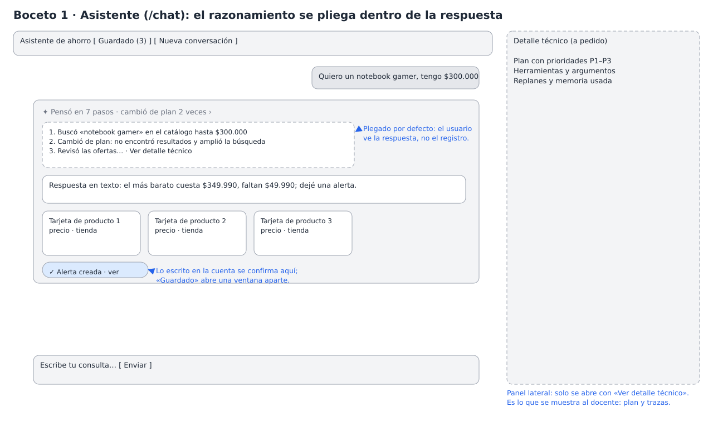
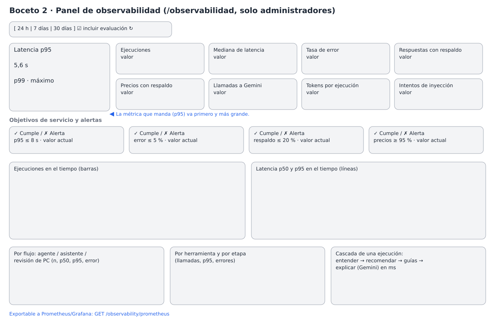
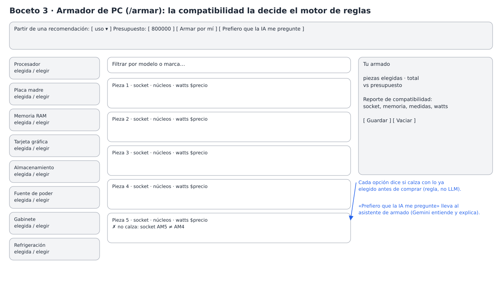

# Bocetos de diseño

Wireframes de baja fidelidad de las tres pantallas principales: qué va en cada zona y por qué (anotaciones en azul).
Se regeneran con `python docs/bocetos/generar_bocetos.py`. Las pantallas construidas están en `frontend/app/` y sus
capturas, en `docs/entrega/capturas/`.

| Boceto | Pantalla | Decisión de diseño principal | Captura real |
|---|---|---|---|
| [01-asistente.svg](01-asistente.svg) | `/chat` | El razonamiento del agente va **plegado** sobre cada respuesta y en lenguaje simple; el detalle técnico (plan P1–P3, herramientas, replanes) solo se abre a pedido; lo guardado se confirma en la respuesta y se consulta en una ventana aparte | — |
| [02-observabilidad.svg](02-observabilidad.svg) | `/observabilidad` | La latencia p95 primero y más grande; objetivos de servicio con texto e ícono (no solo color); series en el tiempo; tablas por flujo, herramienta y etapa; cascada de cada ejecución | `01-observabilidad.png`, `01b-panel-indicadores.png`, `02-traza-21s.png` |
| [03-armador.svg](03-armador.svg) | `/armar` | Cada opción dice si calza con lo ya elegido **antes** de comprar; la compatibilidad la decide el motor de reglas, no el LLM | `05-armador.png`, `09-asistente.png` |

