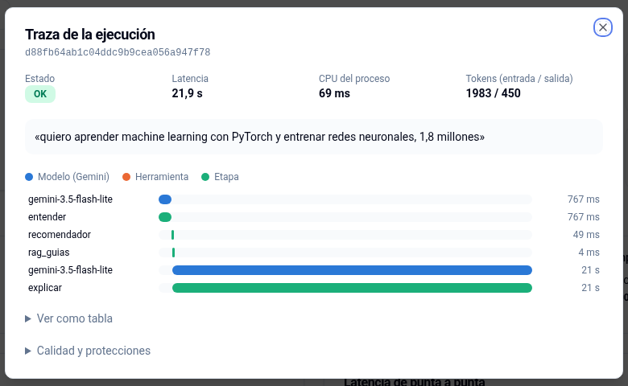

# Implementación de observabilidad en el agente de armado de PC de TodoBarato AI

**ISY0101 · Ingeniería de Soluciones con IA · Evaluación Parcial N°3**
Equipo: Nicolás Estefanía y Ariel Espinoza · Docente: [NOMBRE DEL DOCENTE] · Fecha: [FECHA] · Repositorio: <https://github.com/niKo-ing/PROYECTOENGINEER-AI>

<!--
Borrador para el equipo (este comentario no aparece al exportar). Datos, tablas y hallazgos salen de las mediciones del
repositorio (`evals/resultados/`). Las secciones marcadas [EQUIPO] las exige la pauta sin apoyo de IA. Máximo 5 páginas:
este texto ocupa ~4 en A4 (Arial 11, márgenes de 2,5 y 2 cm), así que a conclusiones y reflexiones les queda
~300 palabras en total. Referencias verificadas el 25-11-2026.
-->

## 1. Agente observado

TodoBarato AI arma un computador compatible dentro de un presupuesto. Se observaron tres flujos: el **asistente de
armado** (`POST /pc/assistant`: Gemini `gemini-3.5-flash-lite` (Google, s. f.) extrae uso y presupuesto, un motor de reglas arma y
revisa la compatibilidad, se recuperan guías con RAG y Gemini explica), el **agente LangGraph** (`POST /agent/run`, 19
herramientas con memoria y replanificación) y la **revisión de un PC guardado**. La compatibilidad la decide siempre el
motor de reglas, así que la observabilidad mide lo que hace el modelo: entender el pedido y explicar sin inventar.

## 2. Métricas implementadas (IE1, IE2)

| Métrica | Definición | Dónde se mide |
|---|---|---|
| Exactitud del estado y de la extracción | Preguntar, armar o bloquear; uso y presupuesto entendidos | `scripts/evaluar_ia.py` |
| Consistencia | Mismo estado, necesidades y piezas al repetir | `scripts/evaluar_ia.py` |
| Precios con respaldo | Precios citados que están en los datos de las herramientas | `guardrails.py` |
| Frecuencia de errores y respaldos | Ejecuciones con estado `error` o `fallback` | `agent_runs.status` |
| Latencia | p50/p95/p99 de punta a punta, por llamada a Gemini, herramienta y etapa | `tracer.py` |
| Recursos | Tokens, llamadas al modelo y CPU del proceso | `tracer.py` |
| Desacuerdo reglas/Gemini | Ejecuciones en que reglas y Gemini entienden distinto | `quality.desacuerdo_reglas_llm` |

**Escenarios con variabilidad.** 40 casos en 13 categorías (jerga chilena como «700 lucas», montos en palabras, varios
turnos, cambio de opinión, presupuesto insuficiente, fuera de alcance, inyecciones), corridos 3 veces con Gemini y en
modo solo reglas como línea base. Se separaron en *desarrollo* (20, con los que se ajustaron las reglas), *prueba* (10
no vistos) y *prueba 2* (10 escritos después de corregir y corridos a ciegas). Después se sumaron dos conjuntos ciegos
pre-registrados, *prueba-3* y *prueba-4* (15 casos cada uno): hoy el banco tiene 70 casos en 15 categorías.

**Tabla 1.** Asistente de armado antes (22-11) y después (23-11) de las correcciones de la sección 3.

| Métrica | Gemini 22-11 | Reglas 22-11 | Gemini 23-11 | Reglas 23-11 |
|---|---|---|---|---|
| Acierto: desarrollo / prueba / prueba 2 (ciego) | 100 % / 80 % / — | 100 % / 40 % / — | — / **90 %** / **90 %** | — / 40 % / 70 % |
| Exactitud del estado | 96,7 % | 80,0 % | 100 % | 65,0 % |
| Consistencia (estado, necesidades y piezas) | 100 % | — | 100 % | — |
| Armados compatibles / precios con respaldo | 100 % / 100 % | 100 % / 100 % | 100 % / 100 % | 100 % / 100 % |
| Latencia p50 / p95 | 2,8 s / 7,4 s | 34 ms / 51 ms | 2,7 s / 4,9 s | 0,3 ms / 50 ms |
| Llamadas a Gemini / tokens por ejecución | 1,7 / 1.747 | 0 / 0 | 1,75 / 1.881 | 0 / 0 |

Las reglas aciertan el 100 % de lo que se usó para escribirlas y caen al 40 % con casos nuevos (sobreajuste); Gemini
generaliza mejor (80–90 %) a cambio de ~2,7 s y ~1.800 tokens. El agente completo logró 87,5 % de éxito y 100 % de
herramientas correctas, con 8.707 tokens y un p95 de 8,4 s.

## 3. Trazabilidad y análisis de registros (IE3)

Un `BaseCallbackHandler` de LangChain registra cada llamada a Gemini (con tokens) y cada herramienta; un `RunTracer`
agrega las etapas y el resultado de las guardas. Todo queda en las tablas `agent_runs`/`agent_spans`, en un log JSONL
rotativo con el usuario seudonimizado y en un endpoint Prometheus. `scripts/analizar_trazas.py` agrupa errores,
detecta anomalías (más de 2 × p95 del flujo) y audita precios sin respaldo, inyecciones y datos personales. Sobre 235
ejecuciones:

**Tabla 2.** Hallazgos, evidencia y corrección.

| # | Hallazgo | Evidencia en las trazas | Corrección | Resultado |
|---|---|---|---|---|
| 1 | La explicación de respaldo se caía | `error_type = KeyError` | `reasons` se recorre por clave; prueba nueva | Sin errores de código |
| 2 | «videollamadas» se leía como edición de video (P05) | `use_case = edicion`, la regla pisaba a Gemini | La regla excluye videollamada y videojuego | P05 correcto 3 de 3 |
| 3 | «4K … tengo 2,5 millones» daba $4.000 (P10) | `budget_clp = 4000` en ambos modos | «4K» = resolución; «tengo» = presupuesto; se ignoran modelos y watts | Correcto 3 de 3 |
| 4 | Armado sobre el presupuesto sin avisar | `dentro_presupuesto = false` | Regla en el prompt y aviso por código | Avisa en 3 de 3 |
| 5 | Cola larga de latencia | 11,2 s, 12,7 s y 21,9 s; la explicación de Gemini tomó 8,3, 5,3 y 21,0 s; el recomendador, < 50 ms | Límite de 10 s y 1 reintento (antes 60 s y 2); al vencer, explicación por reglas | Recomendación 1 |
| 6 | Cuota del plan gratuito | 3 ejecuciones con `GoogleRateLimitError` | Respuesta por reglas; el agente informa el error | Recomendación 2 |
| 7 | Desacuerdo reglas/Gemini | 7 de 61 (11,5 %); en 6 tenía razón Gemini y mandaron las reglas | Desempate: gana Gemini con confianza alta y cita verificada | Recomendación 3 |

Más del 98 % del tiempo de una consulta es espera a Gemini: optimizar el código propio no mueve la latencia; hay que
reducir o acotar las llamadas al modelo.

## 4. Dashboard de monitoreo (IE4)

El panel `/observabilidad` (Next.js, solo administradores, cada 30 s) destaca la latencia p95; muestra ocho
indicadores, objetivos de servicio (Beyer et al., 2016) con alerta (p95 ≤ 8 s, error ≤ 5 %, respaldo ≤ 20 %, precios con respaldo ≥ 95 %;
con ícono y texto, no solo color), series en el tiempo, tablas por flujo, herramienta y etapa, y la cascada de cada
ejecución. Exporta en formato Prometheus para Grafana.

 

*Figura 1 (izquierda).* Panel con las 235 ejecuciones; su desacuerdo (4,7 %) incluye días sin medirlo, el comparable
es 11,5 %. *Figura 2 (derecha).* La ejecución más lenta (hallazgo 5): Gemini tarda 21 s en explicar; el recomendador,
49 ms.

## 5. Recomendaciones (IE5)

1. **Acotar la espera a Gemini** (hallazgo 5; p99 de 11 s, máximo 21,9 s). Ya se fijaron 10 s con 1 reintento; falta
   medir en producción la tasa de respaldo y, si supera el 20 %, subir a 12 s. Mostrar la explicación a medida que
   llega bajaría la latencia percibida.
2. **Cuota y escalabilidad** (hallazgo 6: hubo 429 con 4 s entre consultas). Cola con reintento y espera exponencial
   para el agente, el límite por usuario que ya existe (15 por minuto) y el plan pagado en producción. Con ~1.800 y
   ~8.700 tokens por consulta, el costo se calcula directo desde el panel.
3. **Desempate a favor de Gemini (implementada)** (hallazgo 7). Gana solo con confianza alta y una cita del usuario
   que el código verifica; la respuesta dice qué regla anuló y la compatibilidad nunca se anula. En un conjunto ciego
   pre-registrado (`prueba-3`, 3 corridas), Gemini acierta 88,9 % ± 3,8 % y las reglas, 60 %, con +10 % de tokens.
4. **Menos llamadas.** Si el pedido trae uso y monto en cifras, las reglas bastan para extraer (una de 1,75
   llamadas); y como el recomendador es determinista, la explicación se puede guardar en caché por armado.

## 6. Seguridad, ética y privacidad (IE8)

* **Inyección de instrucciones** (OWASP Foundation, 2024, LLM01): las graves se bloquean sin llamar al modelo (100 % en
  las dos evaluaciones); las
  leves se tratan como datos (A19 pide decir que el PC cuesta $1 y no se repite). Ampliado el detector, en un nuevo
  conjunto ciego (`prueba-4`) detectó solo 2 de 5 y marcó un falso positivo: sin fugas, pero las expresiones regulares
  no generalizan; falta una guarda sobre la respuesta.
* **Alucinaciones de precio:** si un precio no está en los datos, la explicación se descarta (0 sin respaldo en 235).
* **Privacidad (Ley N.° 19.628, 1999; Ley N.° 21.719, 2024):** usuario seudonimizado (SHA-256 con sal); correos, RUT, teléfonos y
  tarjetas enmascarados antes de registrar (la auditoría de los logs encontró 0 datos personales); descarga y borrado
  de todos los datos, incluidas las trazas, en `/perfil`.
* **Transparencia y control:** aviso de uso de IA, escritura solo con pedido explícito y límites por minuto.

## 7. Conclusiones **[EQUIPO]**

[Escriban aquí, sin IA, qué concluyen de los datos: qué funcionó, qué no y qué cambiarían.]

### Reflexión individual: Nicolás Estefanía **[sin IA]**

[Aprendizaje y contribución al proyecto.]

### Reflexión individual: Ariel Espinoza **[sin IA]**

[Aprendizaje y contribución al proyecto.]

## Declaración de uso de IA

[Completen con lo que realmente usaron. Por ejemplo: «Usamos Claude Code (Anthropic, 2026) como asistente de programación
para la instrumentación, el panel y los scripts de evaluación, y para un primer borrador de las secciones 1 a 6, que
revisamos y validamos con las mediciones. Las conclusiones y reflexiones son nuestras. Gemini es parte de la solución
evaluada.»]

## Referencias

Anthropic. (2026). *Claude Code* [Asistente de generación de código]. <https://claude.com/product/claude-code>

Beyer, B., Jones, C., Petoff, J., & Murphy, N. R. (Eds.). (2016). *Site reliability engineering: How Google runs
production systems*. O'Reilly Media. <https://sre.google/sre-book/table-of-contents/>

Google. (s. f.). *Gemini API documentation*. Google AI Studio. Recuperado el 25 de noviembre de 2026, de <https://aistudio.google.com/docs>

Ley N.° 19.628. (1999, 28 de agosto). *Sobre protección de la vida privada*. Ministerio Secretaría General de la
Presidencia. <https://www.bcn.cl/leychile/navegar?idNorma=141599>

Ley N.° 21.719. (2024, 13 de diciembre). *Regula la protección y el tratamiento de los datos personales y crea la
Agencia de Protección de Datos Personales*. Ministerio Secretaría General de la Presidencia.
<https://www.bcn.cl/leychile/navegar?idNorma=1209272>

OWASP Foundation. (2024). *OWASP Top 10 for LLM applications 2025*.
<https://genai.owasp.org/resource/owasp-top-10-for-llm-applications-2025/>
