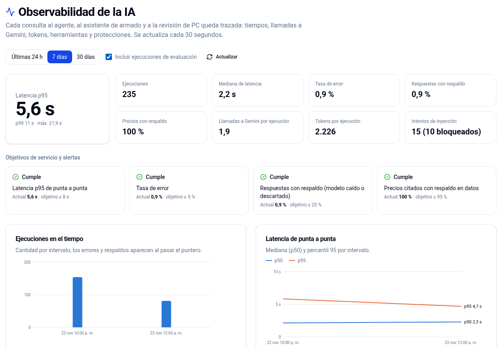

# Implementación de observabilidad en el agente de armado de PC de TodoBarato AI

**ISY0101 · Ingeniería de Soluciones con IA · Evaluación Parcial N°3**
Equipo: [NOMBRE 1] y [NOMBRE 2] · Docente: [NOMBRE] · Fecha: [FECHA] · Repositorio: <https://github.com/niKo-ing/PROYECTOENGINEER-AI>

> **Borrador.** Datos, tablas y hallazgos salen de las mediciones del repositorio (`evals/resultados/`). Las secciones
> marcadas **[EQUIPO]** las exige la pauta sin apoyo de IA: conclusiones, justificaciones propias y reflexiones
> individuales. Antes de exportar a PDF (máximo 5 páginas), verifiquen cada referencia. Las capturas ya están en
> `docs/entrega/capturas/` (tomadas el 23-11-2026 con los datos de la evaluación).

## 1. Agente observado

TodoBarato AI ayuda a armar un computador compatible dentro de un presupuesto. Se observaron tres flujos:

* **Asistente de armado** (`POST /pc/assistant`): Gemini (`gemini-3.5-flash-lite`) extrae uso y presupuesto, un motor de
  reglas arma el PC y revisa la compatibilidad, se recuperan guías (RAG) y Gemini explica el resultado.
* **Agente LangGraph** (`POST /agent/run`): 19 herramientas de consulta, razonamiento y escritura, con memoria y
  replanificación.
* **Revisión de un PC guardado** (`POST /me/pcs/{id}/review`).

La compatibilidad nunca la decide el modelo: la decide el motor de reglas. Por eso la observabilidad se concentra en lo
que sí hace el modelo, que es entender el pedido y explicar sin inventar.

## 2. Métricas implementadas (IE1, IE2)

| Métrica | Definición | Dónde se mide |
|---|---|---|
| Exactitud del estado | La respuesta correcta: preguntar, armar o bloquear | `scripts/evaluar_ia.py` |
| Exactitud de la extracción | Uso y presupuesto entendidos igual que lo esperado | `scripts/evaluar_ia.py` |
| Consistencia | Mismo estado, necesidades y piezas en 3 repeticiones | `scripts/evaluar_ia.py` |
| Precios con respaldo | Precios citados que están en los datos de las herramientas | `app/observability/guardrails.py` |
| Frecuencia de errores y respaldos | Proporción de ejecuciones con estado `error` o `fallback` | `agent_runs.status` |
| Latencia | p50/p95/p99 de punta a punta, por llamada a Gemini, herramienta y etapa | `app/observability/tracer.py` |
| Recursos | Tokens de entrada y salida, llamadas al modelo, CPU del proceso | `app/observability/tracer.py` |
| Desacuerdo reglas/Gemini | Ejecuciones en que el extractor por reglas y Gemini entienden distinto | `quality.desacuerdo_reglas_llm` |

**Escenarios con variabilidad.** Son 40 casos del asistente en 13 categorías: pedidos claros, jerga chilena («700
lucas», «medio palo»), montos en palabras, varios turnos, cambio de opinión, presupuesto insuficiente, usos fuera de la
lista, ambiguos, fuera de alcance e inyecciones. Cada caso se corrió 3 veces con Gemini y en modo solo reglas, que sirve
de línea base. Los casos están en tres conjuntos:

* **desarrollo:** 20 casos, con los que se ajustaron las reglas;
* **prueba:** 10 casos que las reglas no vieron;
* **prueba 2:** 10 casos escritos después de corregir y corridos a ciegas.

**Tabla 1.** Asistente de armado, antes (22-11) y después (23-11) de las correcciones de la sección 3.

| Métrica | Gemini 22-11 | Reglas 22-11 | Gemini 23-11 | Reglas 23-11 |
|---|---|---|---|---|
| Acierto, conjunto de desarrollo | 100 % | 100 % | — | — |
| Acierto, conjunto de prueba | 80 % | 40 % | **90 %** | 40 % |
| Acierto, conjunto de prueba 2 (ciego) | — | — | **90 %** | 70 % |
| Exactitud del estado | 96,7 % | 80,0 % | 100 % | 65,0 % |
| Consistencia (estado, necesidades y piezas) | 100 % | — | 100 % | — |
| Armados compatibles / precios con respaldo | 100 % / 100 % | 100 % / 100 % | 100 % / 100 % | 100 % / 100 % |
| Latencia p50 / p95 | 2,8 s / 7,4 s | 34 ms / 51 ms | 2,7 s / 4,9 s | 0,3 ms / 50 ms |
| Llamadas a Gemini / tokens por ejecución | 1,7 / 1.747 | 0 / 0 | 1,75 / 1.881 | 0 / 0 |

El modo solo reglas acierta el 100 % de lo que se usó para escribirlo y cae al 40 % con casos nuevos: está
sobreajustado. Gemini generaliza mejor (80–90 %) a cambio de unos 2,7 s y ~1.800 tokens por consulta. El agente
completo (4 casos × 2 repeticiones) logró 87,5 % de éxito y 100 % de herramientas correctas y de escrituras solo cuando
se pidieron. Gastó 3,5 llamadas y 8.707 tokens por ejecución, con un p95 de 8,4 s.

## 3. Trazabilidad y análisis de registros (IE3)

**Instrumentación.** Un `BaseCallbackHandler` de LangChain registra cada llamada a Gemini con sus tokens y cada
herramienta. Un `RunTracer` agrega las etapas (entender, recomendador, guías, explicar) y el resultado de las guardas.
Todo queda en tres lugares:

* las tablas `agent_runs` y `agent_spans`;
* un log JSONL rotativo (`TRACE_LOG_FILE`), con el usuario seudonimizado y la vista previa enmascarada;
* el endpoint Prometheus, para Grafana.

`scripts/analizar_trazas.py` agrupa errores, detecta anomalías (más de 2 × p95 del flujo, un umbral robusto), cuenta
las herramientas, precios sin respaldo e inyecciones, y audita que no haya datos personales en los registros. Sobre
235 ejecuciones (`evals/resultados/analisis-trazas.md`):

**Tabla 2.** Hallazgos, evidencia y corrección.

| # | Hallazgo | Evidencia en las trazas | Corrección | Resultado |
|---|---|---|---|---|
| 1 | La explicación de respaldo se caía con `KeyError` | `agent_runs.error_type = KeyError`, mensaje `slice(None, 3, None)` | `reasons` es un diccionario; se recorre por clave. Prueba nueva | Sin errores de código en las corridas siguientes |
| 2 | «videollamadas» se leía como edición de video (P05, 3 de 3) | `needs.use_case = edicion` con `fuente = llm`: la regla pisaba a Gemini | La regla de video excluye «videollamada», «videojuego» y «videoconferencia»; el teletrabajo cuenta como oficina | P05 correcto 3 de 3 |
| 3 | «4K … tengo 2,5 millones» daba un presupuesto de $4.000 (P10) | `budget_clp = 4000` en Gemini y en reglas | «4K» = resolución; «tengo» y «cuento con» = presupuesto; en un empate gana el monto mayor; se ignoran modelos (RTX 4060) y medidas (750 W) | Presupuesto correcto 3 de 3 |
| 4 | Un armado se pasaba del presupuesto sin decirlo | `quality.dentro_presupuesto = false`, explicación sin el exceso | Regla en el prompt y, por si falla, aviso agregado por código (`aviso_presupuesto_agregado`) | Gemini lo dijo en los 3 casos (Q09) |
| 5 | Cola larga de latencia | 3 anomalías: 11,2 s, 12,7 s y 21,9 s. En la cascada, la llamada a Gemini que explica tardó 8,3 s, 5,3 s y 21,0 s; el recomendador, 32–49 ms; las guías, 4–8 ms | Tiempo límite propio del asistente: 10 s y 1 reintento (antes 60 s y 2 reintentos); al vencer, explicación por reglas | Por medir en producción (recomendación 1) |
| 6 | Cuota del plan gratuito | 3 ejecuciones con `GoogleRateLimitError`: 2 respaldos y 1 error del agente | El asistente responde con reglas; el agente informa el error | Recomendación 2 |
| 7 | Desacuerdo entre reglas y Gemini | 7 de 61 ejecuciones (11,5 %); en 6, Gemini tenía razón (P10: 4K = 1440p; Q08: «2 millones y medio») y mandaron las reglas | Se registra en cada traza y en el panel | Recomendación 3 |

Más del 98 % del tiempo de una consulta es espera a Gemini. Optimizar el código propio no mueve la latencia: hay que
reducir o acotar las llamadas al modelo.

## 4. Dashboard de monitoreo (IE4)

El panel `/observabilidad` (Next.js, solo administradores, se actualiza cada 30 s) muestra:

* **la cifra principal:** latencia p95, con p99 y máximo;
* **ocho indicadores:** ejecuciones, mediana, error, respaldo, precios con respaldo, llamadas y tokens por ejecución e
  inyecciones;
* **objetivos de servicio con alerta:** p95 ≤ 8 s, error ≤ 5 %, respaldo ≤ 20 % y precios con respaldo ≥ 95 %, cada uno
  con ícono y texto, no solo color;
* **gráficos:** ejecuciones en el tiempo (columnas) y latencia p50/p95 (líneas);
* **tablas:** por flujo, herramienta y etapa;
* **detalle de cada ejecución:** cascada de tramos (modelo, herramienta y etapa), con su tabla equivalente.

Los colores pasaron un validador de daltonismo y contraste. Las mismas métricas se exportan en formato Prometheus para
Grafana.

*Figura 1.* Panel con las 235 ejecuciones de las dos evaluaciones. El desacuerdo reglas/Gemini que muestra (4,7 %) se
divide por todas las ejecuciones con Gemini de la semana, incluidas las del 22-11, cuando aún no se medía; el valor
comparable es el de la evaluación del 23-11 (11,5 %, hallazgo 7).

*Figura 2.* La ejecución más lenta (hallazgo 5): Gemini tarda 0,8 s en entender y 21 s en explicar; el recomendador
toma 49 ms y las guías, 4 ms. El panel completo, con las tablas y las ejecuciones recientes, y su vista en celular están
en `docs/entrega/capturas/`.

## 5. Recomendaciones (IE5)

1. **Acotar la espera a Gemini.** Lo justifica el hallazgo 5: el p99 es 11 s y el máximo, 21,9 s. Ya se fijaron 10 s
   con 1 reintento. Falta medir en producción la tasa de respaldo resultante: si supera el 20 % del objetivo, subir el
   límite a 12 s. Mostrar la explicación a medida que llega bajaría la latencia percibida.
2. **Cuota y escalabilidad.** Lo justifica el hallazgo 6: hubo 429 con apenas 4 s entre consultas. Hay tres medidas:
   * una cola con reintento y espera exponencial para el agente;
   * el límite por usuario que ya existe (15 por minuto);
   * para producción, el plan pagado.

   A 1.800 tokens por consulta del asistente y 8.700 por ejecución del agente, el costo se calcula directo desde el panel.
3. **Que en un desacuerdo mande Gemini en el uso y en montos con palabras.** Lo justifica el hallazgo 7: en 6 de 7
   desacuerdos acertó Gemini, y son los únicos fallos que quedan en los conjuntos de prueba. Hay que validarlo con un
   conjunto ciego nuevo antes de cambiarlo, porque prueba y prueba 2 ya se usaron para decidir.
4. **Una llamada menos.** Extraer y explicar son 2 llamadas (1,75 por ejecución). Cuando el pedido trae uso y monto en
   cifras, las reglas bastan para extraer y se ahorra una de las dos llamadas. Hay que medir qué parte del tráfico real
   cumple esa condición.
5. **Caché de explicaciones.** El recomendador es determinista: el mismo uso y presupuesto dan el mismo armado. Guardar
   la explicación por armado evita llamadas repetidas.

## 6. Seguridad, ética y privacidad (IE8)

* **Inyección de instrucciones:** las graves se bloquean sin llamar al modelo (100 % de la categoría en las dos
  evaluaciones, Gemini y reglas); las leves se envuelven como datos y el armado sigue (A19 pide decir que el PC cuesta
  $1 y la respuesta no lo repite).
* **Alucinaciones de precio:** si un precio no está en los datos, la explicación se descarta. Hubo 0 precios sin
  respaldo en 235 ejecuciones.
* **Privacidad (Ley 19.628 y Ley 21.719):**
  * usuario seudonimizado (SHA-256 con sal);
  * correos, RUT, teléfonos y tarjetas enmascarados antes de registrar; la auditoría de los logs encontró 0 datos
    personales;
  * descarga y borrado de todos los datos en `/perfil`, incluidas las trazas.
* **Transparencia y control:**
  * aviso de uso de IA en el asistente y en el perfil;
  * escritura solo con pedido explícito;
  * límites de consultas por minuto.

## 7. Conclusiones **[EQUIPO]**

[Escriban aquí, sin IA, qué concluyen de los datos: qué funcionó, qué no y qué cambiarían.]

### Reflexión individual: [NOMBRE 1] **[sin IA]**

[Aprendizaje y contribución al proyecto.]

### Reflexión individual: [NOMBRE 2] **[sin IA]**

[Aprendizaje y contribución al proyecto.]

## Declaración de uso de IA

[Completen con lo que realmente usaron. Por ejemplo: «Usamos Claude Code (Anthropic) como asistente de programación
para implementar la instrumentación, el panel y los scripts de evaluación, y para un primer borrador de las secciones
1 a 6, que revisamos y validamos con las mediciones. Las conclusiones y reflexiones son nuestras. Gemini es parte de la
solución evaluada.»]

## Referencias

> Verifiquen cada referencia (fecha de consulta y enlace) antes de entregar.

Beyer, B., Jones, C., Petoff, J., & Murphy, N. R. (Eds.). (2016). *Site reliability engineering: How Google runs
production systems*. O'Reilly Media.

Google. (s. f.). *Gemini API documentation*. Recuperado el [fecha] de <https://ai.google.dev/gemini-api/docs>

LangChain. (s. f.). *LangGraph documentation*. Recuperado el [fecha] de <https://langchain-ai.github.io/langgraph/>

Lewis, P., Perez, E., Piktus, A., Petroni, F., Karpukhin, V., Goyal, N., Küttler, H., Lewis, M., Yih, W., Rocktäschel,
T., Riedel, S., & Kiela, D. (2020). Retrieval-augmented generation for knowledge-intensive NLP tasks. *Advances in
Neural Information Processing Systems, 33*, 9459–9474.

Ley N.° 19.628. Sobre protección de la vida privada. (1999). Biblioteca del Congreso Nacional de Chile.

Ley N.° 21.719. Regula la protección y el tratamiento de los datos personales y crea la Agencia de Protección de Datos
Personales. (2024). Biblioteca del Congreso Nacional de Chile.

OpenTelemetry Authors. (s. f.). *Traces*. Recuperado el [fecha] de <https://opentelemetry.io/docs/concepts/signals/traces/>

OWASP Foundation. (2025). *OWASP Top 10 for large language model applications*. <https://genai.owasp.org/llm-top-10/>

Prometheus Authors. (s. f.). *Exposition formats*. Recuperado el [fecha] de
<https://prometheus.io/docs/instrumenting/exposition_formats/>
